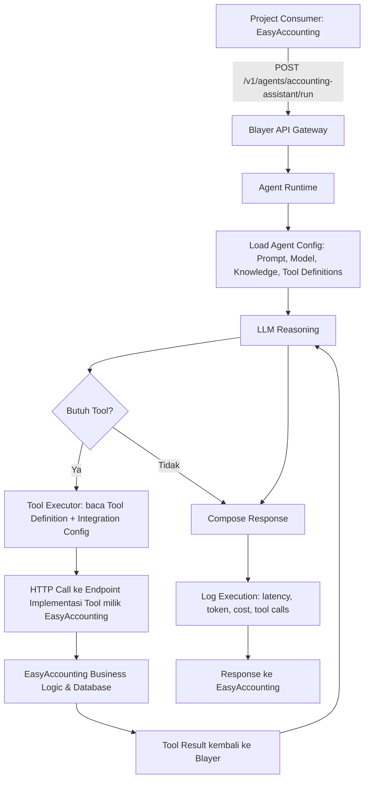

# PRD - Blayer: AI Agent Platform

*As of: 19 September 2026*

## 1. Ringkasan Eksekutif & Problem Statement

**Ringkasan:** Blayer dibangun sebagai **AI Agent Platform / AI Control Plane** — tempat membuat, mengatur, menguji, dan menyediakan AI Agent yang bisa dipakai oleh berbagai aplikasi/project, baik internal (EasyAccounting, Medmon, dll sebagai pilot) maupun oleh **developer di luar tim/organisasi** setelah Blayer dirilis sebagai **open source**. EasyAccounting menjadi *first consumer* untuk memvalidasi arsitektur sebelum dibuka ke publik.

**Masalah:**
- Setiap project internal (EasyAccounting, Medmon, dll) berpotensi membangun logic AI-nya sendiri-sendiri → duplikasi effort, inkonsisten kualitas, dan sulit di-maintain.
- Tidak ada tempat terpusat untuk mengelola prompt, model, knowledge, dan tool AI lintas project.
- Menyimpan AI hanya sebagai `system_prompt` mentah tidak scalable — sulit di-versioning, sulit diuji, sulit dipantau performanya.
- Data bisnis tiap project (mis. data keuangan EasyAccounting) tidak boleh diakses bebas oleh layer AI — perlu batas tanggung jawab yang jelas antara "siapa mendefinisikan tool" dan "siapa menjalankan/mengimplementasikan tool".
- Tidak ada observability (log, cost, error, token usage) terhadap pemakaian AI di seluruh project.
- Di luar sana, developer lain punya masalah serupa (butuh AI Agent Infrastructure), tapi belum banyak platform open source yang menyediakan pola Agent + Tool Contract + Runtime + Observability secara siap pakai dan bisa di-self-host.

**Peluang:** Dengan merilis Blayer sebagai open source, platform ini tidak hanya menyelesaikan masalah internal, tapi juga berpotensi menjadi standar AI Agent Infrastructure yang dipakai komunitas developer luas — mirip posisi Supabase untuk backend atau n8n untuk automation.

## 2. Goals & Success Metrics

**Goal utama:** Blayer menjadi AI Control Plane yang menyediakan Agent siap pakai (via API/SDK) untuk project internal maupun developer eksternal, dengan EasyAccounting sebagai *first consumer* / pilot internal, dan rilis **open source** sebagai tahap lanjutan setelah pilot stabil.

**Metrik sukses (fase internal/pilot):**
- EasyAccounting berhasil menjalankan minimal 1 agent produksi (Accounting Assistant) melalui Blayer API tanpa membangun logic AI sendiri.
- Success rate agent execution ≥ 98% (tidak error/timeout).
- Rata-rata latency response agent ≤ 3 detik untuk request non-tool-heavy.
- Minimal 2 project internal (EasyAccounting + 1 project lain) onboard ke Blayer dalam 6 bulan pertama.
- 100% agent production memiliki versioning yang jelas (tidak ada perubahan prompt langsung ke production tanpa versi).
- Observability tersedia untuk 100% agent execution (log, token usage, cost, tool calls tercatat).

**Metrik sukses (fase open source, pasca-pilot):**
- Blayer dapat di-self-host oleh developer eksternal dengan proses setup (`docker-compose up` / instalasi) di bawah 15 menit.
- Dokumentasi publik (quickstart, API reference, contoh integrasi) tersedia sebelum rilis publik pertama.
- Repository memiliki lisensi **MIT** dan `CONTRIBUTING.md` untuk kontributor.
- Target awal komunitas: minimal 100 GitHub stars & 10 kontributor eksternal dalam 3 bulan pertama pasca-rilis (indikatif, disesuaikan lagi saat perencanaan go-to-market).

**Guardrail metric:** Tidak ada insiden agent melakukan write action (mis. hapus transaksi) tanpa confirmation eksplisit dari user/project — berlaku sama baik untuk pengguna internal maupun eksternal.

## 3. Target User & Persona

**Target utama:** Dua kelompok utama — (1) tim internal yang membangun fitur AI di project perusahaan (fase pilot), dan (2) **developer/tim eksternal** di luar organisasi yang ingin memakai atau men-self-host Blayer sebagai AI Agent Infrastructure (fase open source).

| Persona | Kebutuhan | Peran |
| --- | --- | --- |
| Developer Project Consumer Internal (mis. EasyAccounting) | Memanggil agent siap pakai via API/SDK tanpa mengurus logic AI | Consumer (internal) |
| AI/Platform Engineer (tim Blayer) | Membuat, mengatur, menguji, dan mem-versioning agent; menjaga arsitektur inti tetap solid untuk open source | Builder/Owner |
| Product Owner Project Internal | Memastikan agent sesuai kebutuhan bisnis project (mis. akurasi laporan keuangan) | Stakeholder |
| End User Project Internal (mis. user EasyAccounting) | Mendapat jawaban/analisis dari agent secara akurat dan aman | End Consumer (tidak langsung berinteraksi dengan Blayer) |
| Developer Eksternal (open source) | Instalasi/self-host Blayer, baca dokumentasi, integrasi cepat ke project sendiri | Consumer (eksternal) |
| Kontributor Open Source | Membaca kode, mengajukan PR, memperluas fitur (mis. SDK bahasa baru, integrasi baru) | Contributor |
| Maintainer/Komunitas | Mengelola issue, review PR, menjaga arah roadmap publik — **dipegang langsung oleh founder/product owner di fase awal** | Maintainer |

**Kebutuhan umum:** integrasi cepat (plug-and-play via API/SDK), kepercayaan terhadap akurasi jawaban (grounded ke tool/data asli, bukan karangan), kontrol atas versi agent yang berjalan di production, visibilitas biaya dan performa, **dukungan multi-provider AI (bukan terkunci ke satu vendor)**. **Khusus developer eksternal:** dokumentasi yang jelas, kemudahan self-hosting, lisensi yang jelas, dan arsitektur yang tidak terlalu terikat pada kebutuhan spesifik internal perusahaan.

## 4. Scope (In/Out of Scope & MVP)

**In Scope (MVP — Phase 1 & 2 sesuai roadmap):**
- Agent CRUD: pembuatan, konfigurasi, dan pengelolaan agent (instructions, model, knowledge, tools).
- Agent Builder UI dengan flow: Basic Info → Instructions → Model → Knowledge → Tools → Memory → Guardrails → Playground → Deploy.
- Tool System dengan pemisahan tegas **Tool Definition (contract)** vs **Tool Implementation**:
  - Blayer hanya menyimpan **kontrak tool** — name, description, input schema, output schema, method, endpoint/handler reference — tanpa pernah menyentuh database project.
  - Implementasi tool (query database, business logic) tetap berada dan berjalan di sisi project (mis. EasyAccounting expose endpoint `GET /api/ai/tools/profit-loss`).
  - Pemisahan **READ** vs **WRITE** tool tetap berlaku di level definition (permission & confirmation policy melekat pada definition, bukan implementation).
- **Integration**: entitas baru yang menyimpan konfigurasi koneksi ke satu project/sistem eksternal (base URL, authentication, API key) sehingga sekumpulan tool bisa dikelompokkan di bawah satu Integration (mis. "EasyAccounting Integration").
- Dua cara mendaftarkan tool: (a) manual via dashboard Blayer (isi form definition), atau (b) via **Blayer SDK** — project consumer register tool + handler langsung dari kodenya sendiri (`blayer.tools.register({...})`), tanpa harus bolak-balik ke UI.
- Knowledge Base terpisah dari prompt (dokumen, database, vector store).
- Playground untuk uji coba agent (lihat prompt → model → tool call → tool result → response).
- Agent Versioning (draft, v1, v2, ..., production) agar perubahan tidak langsung memengaruhi production.
- Project & API Key management (tiap project punya `BLAYER_PROJECT_ID` dan `BLAYER_API_KEY` sendiri).
- API endpoint `POST /v1/agents/{agent_id}/run` + SDK (prioritas TypeScript/JavaScript).
- Observability dasar: log request/response, token usage, latency, tool calls, error, estimasi cost.
- **Model Provider Configuration:** Konfigurasi kredensial AI provider (mis. OpenAI/Anthropic/Google API key) disimpan dan dikelola **di dalam instance Blayer milik pengguna sendiri** (env var/secret store lokal), karena Blayer bersifat self-hosted — tidak ada server pusat milik Blayer yang menyimpan atau menerima API key provider siapa pun. Key dikonfigurasi **per project dan per environment** (development/staging/production), bukan satu key global untuk seluruh instance — sehingga project berbeda atau environment berbeda bisa memakai provider/akun billing yang berbeda pula.
- Guardrail dasar: agent tidak boleh melakukan write action tanpa confirmation, tidak boleh mengarang angka (harus dari tool).
- Pilot integrasi end-to-end dengan **EasyAccounting** (Accounting Assistant Agent). **Agent dan konfigurasi EasyAccounting ini tetap privat** — yang di-open-source-kan hanya platform/core Blayer, bukan agent atau data spesifik EasyAccounting; agent ini tidak dijadikan demo/tutorial publik.
- **Kesiapan open source (setelah pilot stabil):**
  - Pemisahan arsitektur **Core (open source)** vs **kebutuhan spesifik internal perusahaan** — konfigurasi/agent milik EasyAccounting tidak boleh menempel ke kode inti Blayer.
  - Self-hosting: paket instalasi (mis. Docker/Docker Compose) agar developer eksternal bisa menjalankan Blayer di infrastrukturnya sendiri.
  - Dokumentasi publik: quickstart, API reference, contoh integrasi/SDK, panduan kontribusi (`CONTRIBUTING.md`).
  - Branding: nama **Blayer** dengan domain resmi **blayer.id**.
  - Lisensi open source: **MIT** (dipilih untuk fase awal agar adopsi semudah mungkin, tanpa batasan komersial).
  - Multi-tenancy yang aman untuk skenario **cloud-hosted/managed Blayer** (opsional, jika nanti disediakan versi cloud selain self-hosted) — isolasi antar akun eksternal yang tidak saling kenal, bukan cuma antar-project internal yang saling percaya.
  - Rate limiting & fair-usage policy per API key, karena pengguna eksternal tidak bisa diasumsikan "trusted" seperti project internal.

**Out of Scope (fase awal / Phase 5 ke depan):**
- Multi-agent orchestration / agent-to-agent communication.
- Autonomous workflow & complex workflow builder.
- Agent marketplace publik (berbagi/jual-beli agent antar pengguna eksternal) — bisa jadi arah jangka panjang setelah komunitas open source terbentuk, bukan prioritas rilis pertama.
- Long-term memory lintas sesi yang kompleks (cukup memory dasar per-sesi di MVP).
- Scheduled agent / event-triggered agent otomatis.
- Human-in-the-loop approval workflow yang kompleks.
- SDK bahasa selain TypeScript/JavaScript (PHP menyusul, bukan prioritas MVP; SDK bahasa lain bisa didorong dari kontribusi komunitas pasca open source).
- **Model bisnis: murni open source.** Tidak ada rencana versi managed/cloud-hosted berbayar (Blayer Cloud) di roadmap saat ini — fokus sepenuhnya pada self-hosted open source. Poin "Multi-tenancy untuk skenario cloud-hosted" di atas tetap dijaga di level arsitektur (agar tidak menutup opsi di masa depan), tapi bukan fitur yang dibangun atau dikomersialkan pada fase ini.

**Batasan arsitektur kunci (prinsip Control Plane vs Data Plane):**
- **Blayer mengatur AI, project menguasai data.** Blayer tidak pernah menyimpan atau mengakses database project secara langsung — Blayer hanya menyimpan *contract* (definisi) tool.
- Relasinya bukan circular dependency, melainkan **runtime dependency satu arah**: `EasyAccounting → Blayer (agent run) → EasyAccounting API (tool call) → Database EasyAccounting`. Panggilan terakhir ke data selalu terjadi sebagai *tool execution* milik project, bukan akses langsung Blayer ke database.
- Blayer bahkan tidak perlu tahu tool itu diimplementasikan oleh project mana — selama endpoint memenuhi contract (input/output schema) yang didaftarkan, implementasi di baliknya bisa diganti (project lain, atau mock API) tanpa mengubah definisi di Blayer.
- Analogi: **Blayer = otak**, **project (mis. EasyAccounting) = tubuh**, **tool = tangan**. Otak memerintah "ambil laporan laba rugi"; tangan (implementasi di project) yang tahu caranya — otak tidak perlu tahu di mana database berada.

## 5. Functional Requirements / Fitur Utama

| Fitur | Deskripsi | Prioritas |
| --- | --- | --- |
| Agent CRUD & Configuration | Membuat/mengedit agent: instructions, model, knowledge, tools, memory, guardrails | Must |
| Multi-Provider Model Support | Agent bisa memilih provider AI (OpenAI, Anthropic/Claude, Google/Gemini, dll) per agent — bukan terkunci ke satu vendor sejak MVP | Must |
| Agent Builder (Wizard UI) | Flow step-by-step pembuatan agent hingga deploy | Must |
| Tool Definition Registry | Simpan kontrak tool (name, description, input/output schema, method, endpoint), tanpa menyimpan data bisnis project | Must |
| Integration Management | Kelola koneksi per project/sistem eksternal (base URL, auth, API key) sebagai wadah sekumpulan tool | Must |
| Tool Permission (Read/Write) | Penandaan read vs write pada level tool definition. **Mekanisme confirmation ditangani di sisi Blayer**: eksekusi WRITE tool berhenti sejenak di Agent Runtime, mengembalikan status "pending confirmation" ke pemanggil (API/Playground), dan baru dieksekusi setelah ada konfirmasi eksplisit lewat API/SDK — bukan dilempar ke UI project consumer untuk ditangani sendiri | Must |
| Tool Executor | Komponen runtime yang mengeksekusi HTTP call ke endpoint implementasi tool milik project saat agent butuh data | Must |
| SDK Tool Registration | Kemampuan project mendaftarkan tool + handler langsung dari kode (`blayer.tools.register`) tanpa lewat UI | Should |
| Knowledge Base Management | UI untuk upload/kelola dokumen, koneksi database, vector store, terpisah dari prompt. **Konten dikelola oleh tim pemilik project (mis. tim EasyAccounting mengisi dokumentasi akuntansi/pajak sendiri), Blayer hanya menyediakan platform/UI-nya** | Must |
| Playground | Uji interaktif agent: lihat reasoning, tool call, tool result, response akhir | Must |
| Agent Versioning | Draft → v1..vN → Production, dengan kemampuan rollback | Must |
| Deployment Layer | Publish agent ke environment (development/staging/production) | Must |
| Project Workspace | Pengelompokan agent/tool/knowledge per project (EasyAccounting, Medmon, dll) | Must |
| API Key & Authentication | Generate & kelola API key per project, scope akses per project | Must |
| Agent Run API & SDK | Endpoint `run` + SDK TypeScript untuk memanggil agent dari project consumer | Must |
| Observability & Logs | Pencatatan request, latency, token usage, tool calls, error, cost per eksekusi | Must |
| Guardrails Enforcement | Aturan agent (mis. tidak boleh mengarang angka, write butuh confirmation) | Must |
| Memory (dasar) | Menyimpan konteks percakapan dalam satu sesi | Should |
| Model Provider Key Management | Simpan & kelola API key AI provider (OpenAI/Claude/Gemini dll) di dalam instance self-hosted milik pengguna sendiri, **di-scope per project dan per environment** (development/staging/production), tidak pernah keluar ke server Blayer | Must |
| Token Usage Tracking | Catat konsumsi token (input/output) per eksekusi agent, diagregasi per agent, **per project, per environment**, dan per API key provider, ditampilkan di Analytics Dashboard | Must |
| Agent Analytics Dashboard | Ringkasan requests, success rate, avg latency, token usage, cost, tool calls | Should |
| Evaluation/Test Cases | Dataset uji & regression testing untuk agent (Phase 4) | Could |
| Self-Hosting Package | Docker/Docker Compose (atau setara) agar Blayer bisa dijalankan di infrastruktur developer eksternal | Should (pra-syarat open source) |
| Public Documentation | Quickstart, API reference, contoh integrasi/SDK, panduan kontribusi | Should (pra-syarat open source) |
| Rate Limiting & Fair Usage | Pembatasan request per API key untuk mencegah abuse dari pengguna eksternal yang tidak trusted | Should (pra-syarat open source) |
| Core/Internal Separation | Pemisahan kode inti (open source) dari konfigurasi/agent spesifik internal perusahaan | Must (pra-syarat open source) |

## 6. Non-Functional Requirements

- **Performa:** Latency response agent non-tool-heavy ≤ 3 detik; dengan tool call ≤ 6 detik (tergantung kompleksitas tool eksternal).
- **Skalabilitas:** Mendukung penambahan project dan agent baru tanpa perubahan arsitektur besar. **Strategi isolasi tenant: database terpisah per project** (bukan row-level isolation dalam satu database bersama), agar kebocoran data antar project (agent, knowledge, tool, log) secara teknis tidak mungkin terjadi lewat query yang salah.
- **Keamanan:** Isolasi data antar project lewat database per project sebagaimana di atas; API key per project dengan scope terbatas; kredensial model/AI provider **tersimpan lokal di instance self-hosted pengguna, di-scope per project dan per environment** (bukan di server milik Blayer, karena memang tidak ada) dan tidak ditanam di project consumer; Blayer tidak pernah menyimpan data bisnis project — hanya kontrak tool dan konfigurasi Integration (base URL, auth token ke API project). Untuk fase open source, isolasi ini harus cukup kuat untuk pengguna eksternal yang saling tidak percaya (bukan hanya antar-project internal).
- **Portabilitas/Self-Hosting:** Blayer harus bisa dijalankan tanpa dependensi ke layanan internal perusahaan (mis. tidak hardcode ke sistem auth internal) agar bisa di-self-host oleh siapa pun.
- **Fair Usage:** Rate limiting per API key/akun untuk mencegah penyalahgunaan resource (token/API LLM) oleh pengguna eksternal.
- **Keandalan:** Agent execution success rate ≥ 98%; ada retry/fallback mekanisme saat tool call atau LLM provider gagal.
- **Auditability:** Setiap eksekusi agent tercatat lengkap (siapa, kapan, input, output, versi agent yang dipakai) untuk keperluan audit terutama pada data keuangan (EasyAccounting).
- **Kompatibilitas:** SDK TypeScript/JavaScript sebagai first-class citizen; API berbasis REST/HTTP standar agar mudah diintegrasikan project lain.
- **Cost Control:** Tracking estimasi biaya per agent/project agar penggunaan API LLM pihak ketiga tetap terkontrol.

## 7. User Flow Utama

Poin penting: Blayer (langkah G) hanya membaca **definisi/kontrak tool** dan **konfigurasi Integration**, lalu memanggil endpoint yang diimplementasikan dan dikuasai penuh oleh EasyAccounting (langkah H-I). Blayer tidak pernah query database EasyAccounting secara langsung — ini bukan circular dependency, melainkan runtime dependency satu arah yang berakhir di *tool execution* milik project.

## 8. Risiko & Asumsi

**Asumsi kunci:**
- Project consumer (mis. EasyAccounting) sudah punya API internal yang bisa diekspos sebagai tool (get_transaction, get_profit_loss, dll).
- Tim punya kapasitas membangun Agent Runtime + Tool Executor + Knowledge Retrieval secara paralel dengan Agent Builder UI.
- Model AI pihak ketiga (GPT/Claude/Gemini) tersedia dan stabil untuk dipakai sebagai backend reasoning.
- Volume pemakaian awal (pilot EasyAccounting) cukup kecil sehingga cost API LLM masih terkendali di fase awal.

**Risiko:**
- **Teknis:** Kompleksitas memisahkan Agent Configuration vs Agent Runtime bisa membuat development MVP molor jika tidak dibatasi scope-nya dengan ketat.
- **Keamanan:** Kesalahan desain permission read/write tool bisa membuat agent melakukan aksi destruktif (mis. hapus transaksi) tanpa confirmation.
- **Kontrak tidak sinkron:** Jika endpoint implementasi tool di sisi project berubah (schema/response berbeda) tanpa update ke Tool Definition di Blayer, agent bisa gagal atau salah interpretasi data.
- **Akurasi:** Jika guardrail "tidak boleh mengarang angka" tidak ditegakkan dengan baik, agent bisa memberi informasi keuangan yang salah — risiko tinggi untuk use case akuntansi.
- **Scope creep:** Godaan membangun fitur advanced (multi-agent, autonomous workflow) terlalu awal sebelum fondasi (Agent + Tool + Knowledge + Runtime + Evaluation) matang.
- **Biaya:** Tanpa cost tracking sejak awal, biaya API LLM pihak ketiga bisa membengkak seiring bertambahnya project consumer.
- **Coupling ke kebutuhan internal:** Jika arsitektur dibangun terlalu menempel ke kebutuhan spesifik EasyAccounting sejak awal, akan sulit dipisahkan saat open source — perlu disiplin desain sejak Phase 1.
- **Abuse dari pengguna eksternal:** Tanpa rate limiting/fair usage, API key publik bisa disalahgunakan untuk membebani resource (cost LLM, infra) begitu Blayer dibuka ke luar.
- **Beban maintenance komunitas:** Rilis open source menambah tanggung jawab baru (review PR, jawab issue, jaga dokumentasi) yang perlu direncanakan kapasitasnya, bukan sekadar "push ke GitHub".

**Mitigasi:**
- Ikuti roadmap bertahap (Phase 1-5) dan tegas menolak fitur di luar scope MVP (lihat bagian Out of Scope).
- Wajibkan confirmation step untuk semua WRITE tool sejak awal desain, bukan ditambahkan belakangan.
- Terapkan schema validation otomatis saat tool dipanggil, agar perbedaan antara Tool Definition dan response aktual endpoint langsung terdeteksi sebagai error, bukan silent failure.
- Jadikan update Tool Definition di Blayer sebagai **langkah wajib di deployment checklist** setiap kali endpoint implementasi tool berubah di sisi project — bukan langkah opsional yang menyusul belakangan.
- Uji guardrail "grounded ke tool, bukan karangan" secara eksplisit di Playground sebelum agent dipakai project consumer.
- Bangun observability (log, token usage, cost) sejak Phase 1, bukan ditunda ke fase produksi besar.
- Gunakan EasyAccounting sebagai pilot project untuk memvalidasi arsitektur sebelum onboarding project lain maupun sebelum open source.
- Sejak Phase 1, jaga agar konfigurasi/agent milik EasyAccounting hidup terpisah dari repository inti Blayer (mis. lewat Project workspace, bukan hardcode di core).
- Siapkan rate limiting & fair usage policy sebelum repository dipublikasikan, bukan sesudah insiden terjadi.
- Rencanakan kapasitas tim/maintainer untuk komunitas (triage issue, review PR) sebagai bagian dari fase persiapan open source, bukan pekerjaan sampingan.

## 9. Timeline & Milestone

| Fase | Fokus | Estimasi Durasi |
| --- | --- | --- |
| Phase 1 — Agent Foundation | Project, Agent CRUD, Model config, Instructions, Playground, API, API Key | 6 minggu |
| Phase 2 — Agent Intelligence | Tools, Knowledge, RAG, Function calling, Conversation, Memory dasar | 6 minggu |
| Pilot Integration | Integrasi end-to-end dengan EasyAccounting (Accounting Assistant Agent) | 3 minggu |
| Phase 3 — Production Readiness | Versioning, Deployment layer, Logs, Monitoring, Cost tracking, Error tracking | 4 minggu |
| Evaluasi Pilot & Iterasi | Review metrik sukses, perbaikan berdasar feedback EasyAccounting | 3 minggu berjalan |
| Persiapan Open Source | Pisahkan core dari config internal, self-hosting package, dokumentasi publik, lisensi MIT, rate limiting | 4-6 minggu |
| Rilis Open Source (Public) | Publikasi repository, dokumentasi, pengumuman ke komunitas | 1 minggu |
| Phase 4 — Evaluation (lanjutan, opsional) | Test cases, dataset, regression testing, prompt comparison | Backlog setelah pilot stabil |

**Total estimasi hingga pilot EasyAccounting live di production: ~19 minggu (± 4.5 bulan).**
**Total estimasi tambahan hingga rilis open source publik pertama: +5-7 minggu setelah pilot stabil (~24-26 minggu / ± 6 bulan dari awal proyek).**